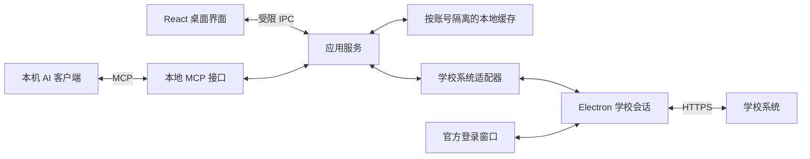

# XJTLU-MCP 开发方案

日期：2026-11-02，更新于 2026-11-03。状态：已按用户选择实现 AMS v0.2，包括聚合首页、公共账号管理、自动登录、Module 课程列表与签到率，以及近期课表。课程作业与 MCP 接入为后续范围。实测状态见 [AMS 记录](ams-prototype.md)。

## 1. 产品目标与第一版范围

做一个优先支持 Windows 的独立桌面软件。用户安装软件、登录自己的学校账号后，本机 AI 客户端通过 MCP 查询有来源的学校信息。学校会话保存在用户设备上。

当前先以 AMS 课表与出勤标记验证桌面登录和真实取数。完整产品再以 Learning Mall 的课程和作业截止时间跑通：

> 安装并打开软件 → 学校官方页面登录 → 读取真实课程和作业 → AI 查询未来七天的作业 → 返回截止时间、来源链接和数据更新时间。

这是建议的首发范围。此前已确定独立应用、TypeScript、Electron 和本地 MCP；学校系统的实际入口、接口和登录兼容性仍需实测。

e-Bridge 课表与成绩、公告搜索、资料下载、DDL 通知可逐步增加。第一版提供只读信息查询。学校资料中出现的文本作为数据处理。

软件负责连接学校系统与 AI 客户端。第一阶段无需内置大模型或模型 API Key；查询结果由用户连接的 AI 客户端使用。

## 2. 推荐结构



界面和 MCP 调用同一组应用服务。课程、作业、时间和缓存规则定义在独立模块中。每个学校系统有自己的适配器，适配器负责把源数据转成统一结构。

初期使用单一仓库和一个应用，不先引入多仓库或微服务。Electron 主进程管理窗口、会话和应用服务，界面通过白名单 IPC 调用服务；较重的解析任务出现后再迁到工作线程。

### 技术选择

| 部分 | 建议 | 用途 |
| --- | --- | --- |
| 主语言 | TypeScript，开启 strict | 在界面、数据层和 MCP 间共享类型 |
| 桌面容器 | Electron | 窗口、官方网页登录、本机会话、托盘 |
| 应用界面 | React + CSS | 连接状态、课程、作业和设置 |
| 开发构建 | electron-vite | 构建主进程、preload 和界面 |
| MCP | 官方 TypeScript SDK | 工具定义、协议处理、传输 |
| 数据验证 | Zod | 校验外部响应和工具输入 |
| 缓存 | 存储接口；原型使用 JSON，查询规模扩大后迁入 SQLite | 保持初期依赖简单，并保留迁移边界 |
| 发布 | electron-builder | Windows 安装包 |
| 验证 | TypeScript 检查、Vitest、Windows 实机验收 | 校验解析、时间、缓存及真实流程 |

electron-vite 提供三个执行环境的统一构建配置，并有 electron-builder 分发说明。[构建文档](https://electron-vite.org/guide/)、[分发文档](https://electron-vite.org/guide/distribution)

初始化时核对并锁定兼容的依赖版本，提交 npm 锁文件。开发机器上的 Node.js 版本与 Electron 内置的 Node.js 版本分别核对。

### 建议目录

```text
src/
  main/                 # 启动、窗口、托盘、IPC 注册
  preload/              # 暴露给本地应用界面的有限 API
  renderer/             # React 界面
  domain/               # 课程、作业、来源、时间和错误类型
  services/             # 连接状态、同步、查询、缓存策略
  providers/
    learning-mall/      # 经验证后实现的请求与解析
    fixtures/           # 明确标记的演示数据
  infrastructure/
    sessions/           # 学校登录与账号会话隔离
    storage/            # 本地配置与缓存
  mcp/                  # 工具定义、结果映射、传输
tests/fixtures/         # 脱敏后的响应样本
docs/                   # 设计、实测记录、客户端连接说明
```

## 3. 最先验证：登录与真实取数

西浦在校学生页面分别列出 Learning Mall 与 e-Bridge，因此按不同来源接入，不预设它们共用登录状态或接口。[学校入口](https://www.xjtlu.edu.cn/zh/current-students)

验证过程：

1. 从官方入口确认当前学生系统与 SSO 跳转域名，记录实际使用的页面和版本。`core.xjtlu.edu.cn` 与课程系统的关系也在此确认。
2. 在独立学校登录窗口加载官方 HTTPS 页面，由用户完成登录和验证码。
3. 为该账号使用独立的持久化 session；先通过受保护资源确认登录有效，再将状态显示为已连接。
4. 在同一学校 session 中尝试请求已观察到的只读接口，按实际情况处理 CSRF、分页和响应格式。
5. 接口不可独立复用时，验证在受控网页上下文内读取所需数据。只有必要时保留隐藏网页，并在空闲时释放。
6. 完全退出并重启软件，再次读取同一条真实数据；随后测试退出账号和会话失效。

Electron 支持以 `persist:` 分区保存浏览器 session，并提供使用 Chromium 网络栈的 `session.fetch()`。这为复用学校会话提供了实现基础，实际认证能否成功仍取决于学校系统。[session 文档](https://www.electronjs.org/docs/latest/api/session)

不能把普通 Node.js fetch 当作自动继承 Electron 登录状态的请求工具，也不能把“页面打开了”当作登录成功。若内置登录被学校阻止，需要单独验证可用的外部浏览器衔接方式。

实测记录只保存脱敏的路径、字段结构和行为。密码、Cookie、Token、学生个人数据不进入仓库或调试日志。

### Electron 的实现边界

本地应用界面与学校网页使用不同 session。远程网页关闭 Node 集成，启用 context isolation 与 sandbox，不加载应用界面的高权限 preload。导航、弹窗与 IPC 均按已验证的来源限制，不关闭证书校验或 webSecurity。[Electron 安全说明](https://www.electronjs.org/docs/latest/tutorial/security)

用户主动退出账号时，停止同步并清理该账号的本地会话和缓存，避免切换账号后看到前一个账号的数据。

## 4. 数据与查询规则

统一模型至少包含以下字段：

- 课程：来源系统、来源 ID、课程代码、课程名称、原文链接。
- 作业：来源 ID、所属课程、标题、截止时间、时间依据、可验证的提交状态、原文链接。
- 查询结果：账号隔离标识、读取时间、最近成功同步时间、是否过期、是否完整、失败来源。

截止时间使用带时区的时间值；有明确时区依据时按学校规则解释，在界面默认以 Asia/Shanghai 展示。缺少截止时间、时区不明或页面未提供提交状态时保留未知状态，不推测。

查询先使用仍有效的缓存，过期后尝试刷新；并发查询合并刷新请求，设置超时与请求频率上限。刷新失败时可返回清晰标记的旧缓存，并同时报告失败原因。部分课程读取失败时标记结果不完整，不能把失败转换成“没有作业”。

源系统提供个性化延期时间时，需要区分它与课程默认截止时间。去重使用来源系统和来源 ID，不能仅按作业标题合并。

演示模式和真实模式分别标记、分别存储。演示数据用于验证应用流程，真实接入验收必须使用用户账号实际返回的数据。

## 5. MCP 接入

第一版先提供三个工具：

| 工具 | 输入 | 返回 |
| --- | --- | --- |
| `get_connection_status` | 无 | 来源连接状态、数据更新时间、是否需要重新登录 |
| `list_courses` | 可选学期与分页参数 | 课程列表、来源与完整性信息 |
| `list_assignments` | 可选课程、时间范围与分页参数 | 作业、截止时间、来源与完整性信息 |

公告工具在课程与作业链路稳定后加入。工具参数使用受限的数据字段；学校请求地址由适配器决定。认证失败等预期错误使用稳定的错误类型，并说明是否可以重试。

### 传输与客户端兼容

优先验证桌面应用提供绑定 `127.0.0.1` 的 Streamable HTTP MCP 接口。每个连接需要本机凭证，并校验 Host 与 Origin，限制请求体和超时。凭证由应用管理，可撤销，不能写入 URL 或日志。回环监听、Origin 校验和认证也是 MCP 规范对本地 HTTP 服务的建议。[HTTP 传输规范](https://modelcontextprotocol.io/specification/2026-07-28/basic/transports/streamable-http)

如果首个目标客户端仅支持 stdio，就增加随安装包分发的 stdio 桥接程序，由它连接应用。桥接程序须携带运行时或打包为可执行文件；用未打包的 `node bridge.js` 无法满足用户免装 Node.js 的目标。Windows 下的标准输入输出、退出行为、主应用未启动和安装路径变化均需验证。

stdio 与 Streamable HTTP 都是标准传输，但使用哪种传输不能解决协议版本差异。[传输概览](https://modelcontextprotocol.io/specification/2026-07-28/basic/transports)

实现 MCP 前选定一个真实目标客户端，确认其协议、传输及凭证配置能力。当前官方 SDK 的 v2 已为稳定发布线，v1 是独立维护分支；根据客户端兼容性固定版本，并保持代码与该版本文档一致。[官方 SDK 说明](https://github.com/modelcontextprotocol/typescript-sdk)

本地 MCP 面向能够访问用户本机的 AI 客户端。纯云端 agent 不能直接连接用户电脑的 localhost；远程接入作为后续独立需求设计。

## 6. 用户界面与运行方式

第一版建议三个页面：

1. **连接**：学校来源、登录/退出、登录状态、最近同步结果。
2. **课程与作业**：课程筛选、近期截止时间、刷新、打开原文、数据更新时间。
3. **设置与 AI 连接**：MCP 运行状态、连接配置、凭证管理、清理数据、脱敏诊断。

初期由用户手动启动软件、按需刷新。加入托盘后，首次关闭窗口时明确告知仍在后台运行，并提供完全退出入口。自动启动、周期同步和截止提醒作为后续可选设置加入。

软件运行时才能响应本地 MCP 请求；完全退出后停止后台任务与服务。未来若需要由 AI 客户端自动启动应用，应单独实现启动与单实例协调。

## 7. 开发顺序与验收

| 阶段 | 交付 | 验收条件 |
| --- | --- | --- |
| 0：最小真实验证 | Electron 登录原型、脱敏实测记录 | 登录、读取一门课程的一条真实作业、重启后再读；确认实际失效行为 |
| 1：应用基础 | TypeScript 项目、React 界面、受限 IPC、统一模型、演示适配器 | 可启动和构建，界面清晰标识演示模式，类型检查通过 |
| 2：真实学校适配器 | 课程与作业读取、缓存、错误状态 | 核对原文与截止时间；覆盖分页、部分失败、重新登录、账号清理 |
| 3：MCP 完整流程 | 三个查询工具、客户端配置、必要的 stdio 桥接 | 一个真实客户端可查询未来七天作业，并取得来源和更新时间 |
| 4：可安装预览版 | Windows 安装包、托盘、使用说明 | 干净 Windows 环境免装 Node.js；安装、重启、退出、升级与数据保留行为符合设计 |

阶段 0 的登录、读取和会话结果决定阶段 2 的实现。阶段 1 可以用明确标记的演示数据推进，但真实接入能力以实测结果为准。

自动验证重点放在接口样本解析、日期与延期规则、分页/去重、缓存过期、部分失败、工具输入与账号隔离。真实 SSO、Windows 安装包和目标客户端通过本机验收，不把学校密码放进 CI。

## 8. 开工时优先解决的未知项

1. 实际课程系统入口、学校 SSO 在 Electron 中的行为，以及可用的只读取数路径。
2. 课程分页、个人延期、提交状态与时区字段的真实含义。
3. 首个目标 AI 客户端及其 MCP 协议、HTTP/stdio 与凭证配置能力。
4. 完全退出、重启及服务器主动失效后，会话能保留多久、何时必须重新登录。

当前具体工作：使用 AMS 最小 Electron 原型，在本机验证“登录 → 读取真实课表 → 重启后再次读取”，再推进 MCP 接入。
